# Hand-Controlled Wave Fabric Group 17

**Team Members:** Andrea Spagnolo, Bingxian Zhong, Zhiru Niu  
**Course:** Cyber-Physical Systems (CPS)  
**Repository:** `group17-finalproject-cps`

---

## Table of Contents
1. [Overall Concept & User Interaction](#1-overall-concept--user-interaction)
2. [Mechanical Design & Fabrication](#2-mechanical-design--fabrication)
3. [Hardware Design, Wiring & Power Consumption](#3-hardware-design-wiring--power-consumption)
4. [Repository Structure & Software Pipeline](#4-repository-structure--software-pipeline)
5. [Step-by-Step Setup & Running Instructions](#5-step-by-step-setup--running-instructions)
6. [Machine Learning: Training, Evaluation & Reflection](#6-machine-learning-training-evaluation--reflection)
7. [Troubleshooting Guide](#7-troubleshooting-guide)
8. [External Sources & Libraries Cited](#8-external-sources--libraries-cited)

---

## 1. Overall Concept & User Interaction

### Design Concept & Materiality
Inspired by the unpredictability and movement of the ocean, our **Hand-Controlled Wave Fabric** is an interactive kinetic textile installation that translates touchless human hand gestures into varying, organic wave motion across a fabric with a 3D-printed patterned surface. 
Our intention to achieve a minimalistic yet elegant design drove our design choices; a laser-cut transparent acrylic translucent structural frame with a flexible TPU 3D-printed fabric resting directly above two differently shaped cam mechanisms, which are being rotated by three stepper motors in parallel. We considered that this design would keep attention on the movement itself. 

The complete installation measures `[XX cm]` wide, `[XX cm]` long, and `[XX cm]` high (ZHIRU). Every material and structural choice was made to reinforce the core design concept:

- **Transparent Acrylic Frame:** (ZHIRU WRITE HERE) Laser-cut clear acrylic exposes the three rotating cams and stepper motors on a side, making the mechanical motion an intentional part of the visual experience.
- **3D-Printed Flexible TPU Fabric:** Flexible TPU units are printed onto organza layered over stretch fabric. The cams lift the textile from below, creating gentle waves and shifting patterns of light and shadow.

Interaction is designed to be immediate and intuitive without wearables or physical contact. When no user is present, the fabric moves in a slow, continuous idle ripple. Moving an open palm across the left, centre, or right set threshold areas of the camera shifts the wave intensity to the corresponding section of the fabric, raising two hands drives all three sections at full speed resembling a 'storm', and raising a single index finger pauses the system.


> **[INSERT PHOTO: Clear hero photograph of the completed physical installation showing the transparent frame, the two differently shaped cams, and the TPU 3D-printed fabric on top]**


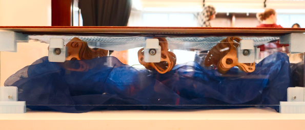

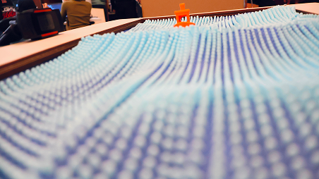
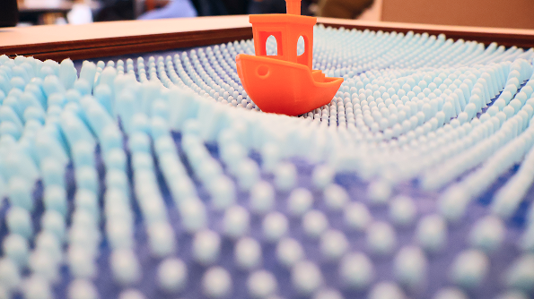
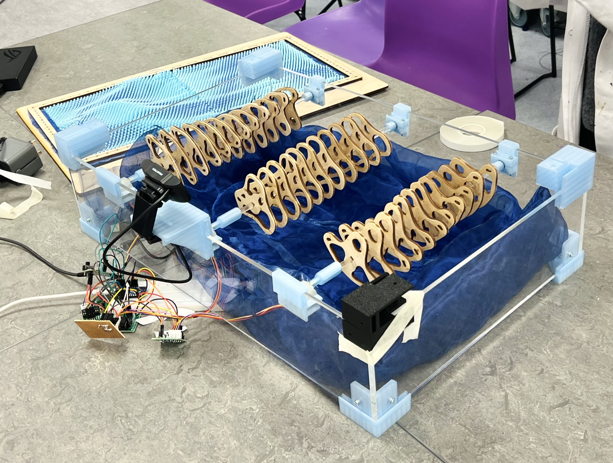


### User Interaction Model
Users interact with the kinetic surface around 40cm away from the frame, where a webcam located in the frame records any user hand gesture. 
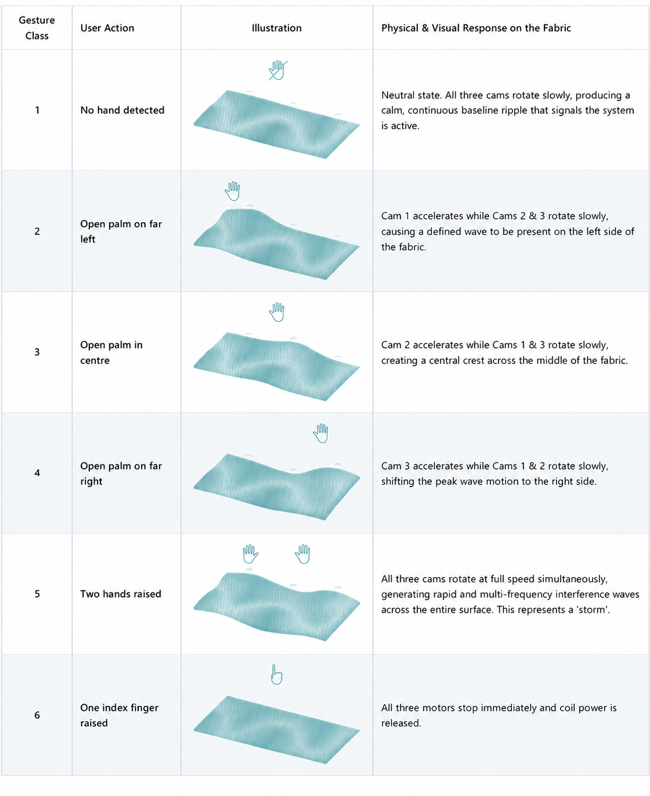

---

## 2. Mechanical Design & Fabrication

Focusing on making our project mechanically simple and elegant, we engineered a dedicated **three-cam kinetic actuation system**, where continuous rotary motion is converted into varied vertical and travelling wave profiles across a flexible TPU textile. The mechanism reaches a fluid, organic deformation by combining two asymmetric rotary cams with a flexible 3D-printed TPU fabric whose own stretch and tensioned weight pull the surface back down into place after each cam pushes it upward.

### Cam Mechanisms, Motion Transmission & Compliant Fabric

### Cam Mechanisms & Motion Transmission

-* **Two Distinct Cam Profiles:** Two custom cams featuring **different shapes and off-centre profiles** are mounted directly onto the 40cm acrylic rods, and then placed into the holders of three `28BYJ-48` stepper motors. As each cam has a unique radial profile due to their angled offsets and different heights, the rotation of these cams displace the TPU textile out of phase, mirroring the organic asymmetry and natural turbulence of the ocean instead of predictable, repetitive motion.

-* **Direct Rotary-to-Surface Contact:** Smooth, wood laser-cut cam perimeters press upwards the underside of the TPU printed fabric, translating continuous 360° stepper rotation into smooth vertical displacement. Friction with the fabric was reduced by sanding the cams perimiters and adding an additional layer of fabric below the first TPU printed layers.

-* **Three Stepper Motors:** Using geared stepper motors with the `AccelStepper` library allows full, continuous 360° cam rotation and smooth, quiet speed changes.

-* **Motor Alignment:** The stepper motors are mounted by pieces of 3D printed translucent blue PLA, where the motors are screwed. These pieces have a clip-on attachment to attach and remove the stepper motors from the sides of the acrylic frame. 

-* **Rod and bearing rotation:** Each cam row is connected by a 40cm squared rod of dimensions 5mm x 5mm. This rod is fitted into...ZHIRU


ZHIRU PHOTOS OF FRAME


  ### Fabrication

- * **3D printed parts connecting frame:** (ZHIRU WRITE HERE) BEARINGS, ETC

- **Top and bottom parts for frame elevation and to add fabric frame:** ..ZHIRU


* **Flexible TPU Textile:** 
Designed in Grasshopper, the pattern varies the height and diameter of printed units to create a more natural wave-like appearance. Flexible TPU 90A units are printed onto organza layered over stretch fabric. Secured around the frame with enough slack to move, the textile rises and falls with the rotating cams.

1. Parametric Generation
   


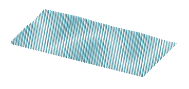

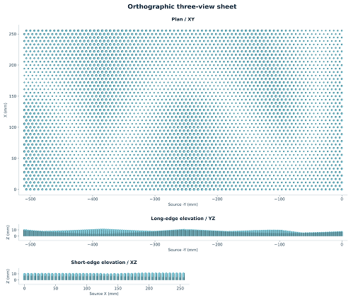


2. 3D print Settings

a. Select the printer model and TPU filament, add a pause after layer 2, and slice the plate.
<p align="center">
  
  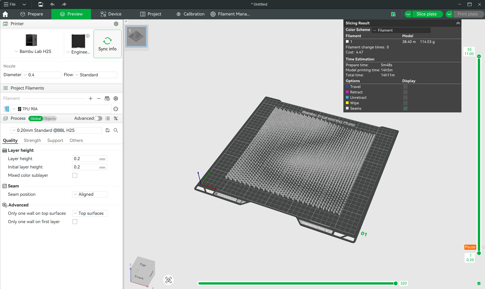
</p>

b. Once layer 2 is complete, secure the fabric with magnets, then resume printing.
<p align="center">
  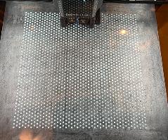
  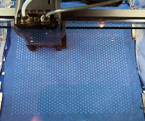
  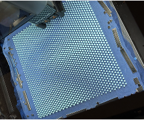
</p>


* - - **Frame to hold and tension fabric:** Holes around the frame allow the fabric to be stitched in place, with enough slack for the cams to lift and lower it freely. A top frame is then secured over the stitched frame with four screws to hold the assembly together.

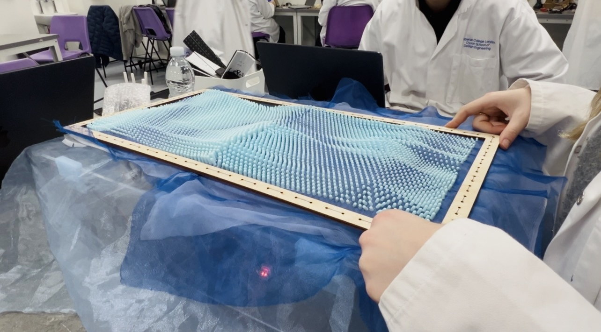


   
* - - **Magnetic boat piece for visual effect:** ZHIRU

> **[INSERT PHOTO / CAD RENDER: Close-up photograph or CAD assembly showing the three differently shaped cams mounted inside the transparent acrylic frame]**

---

## 3. Hardware Design, Wiring & Power Consumption

### Bill of Materials (Components & Justification)

| Component | Qty | Justification |
| :--- | :---: | :--- |
| **Arduino Nano Every** | 1 | 5V logic compatibility, and 12 available I/O pins (`D2–D5`, `D8–D11`, `A0–A3`) to drive all three stepper motors simultaneously. |
| **28BYJ-48 Stepper Motor (5V)** | 3 | Unipolar stepper motor which has internal `64:1` planetary gear, reduction delivering a high torque to lift the tensioned TPU textile smoothly over the cam shapes. |
| **ULN2003 Darlington Driver Board** | 3 | Acts as a power amplifier and electronic switchboard between the Arduino Nano and the motor. |
**USB-C Power Bank & Imperial DSDE Power Board** | 1 | Portable 5 V power bank connected via USB-C to the custom Imperial DSDE Power Board, providing regulated 5 V and 3.3 V breadboard rails, a physical ON/OFF slide switch, and selectable current limiting (`0.5 A` / `2 A`). |
| **Praktika HD USB Webcam (1280×720p)** | 1 | Wide-angle 720p sensor captures left, centre, and right interaction areas.

### Pin Wiring & Electrical Safety
- **Power Distribution (5 V Rail):** A portable USB-C power bank feeds the **Imperial DSDE Power Board**, which plugs directly into the breadboard power rails. The board's **5 V and GND pins** supply power to all three `ULN2003` stepper driver boards (the `3.3 V` rail is unused).
- **Common Ground:** The `GND` and `5V` pins on the Power Board area soldered on a veroboard, on the same rail as the `GND` and `5V` rails of all three `ULN2003` drivers and the Arduino Nano Every's `GND` pin.
- **Cam Motor 1 (Left):** Arduino `D2, D3, D4, D5` $\rightarrow$ ULN2003 #1 (`IN1–IN4`)
- **Cam Motor 2 (Centre):** Arduino `D8, D9, D10, D11` $\rightarrow$ ULN2003 #2 (`IN1–IN4`)
- **Cam Motor 3 (Right):** Arduino `A0, A1, A2, A3` $\rightarrow$ ULN2003 #3 (`IN1–IN4`)

(ANDREA SCHEMATIC/DIGITAL PINOUT SHOWN + PHOTO OF ELECTRONICS)

- **Electrical Safety**
  - **Current Limiting & Hardware Switch:** The Power Board includes a built-in current-limit jumper and an onboard OFF–ON slide switch for immediate hardware power cutoff.
  - **Coil De-Energising:** In Class 6 (All Stop) and automatically upon closing the Processing window, `disableOutputs()` cuts holding current to all twelve motor coils so the steppers do not overheat or drain the power bank when idle.

### Estimated Power Consumption
- **Single Motor Load:** Each `28BYJ-48` stepper motor draws approximately `200–240 mA` at `5 V` (`~1.1–1.2 W`) under cam load.

ANDREA ADD CALCULATIONS!!!

* **Peak System Power (Class 5 — All Three Cams at Full Speed):**
  $$I_{\text{total}} \approx (3 \times 240\text{ mA}) + 50\text{ mA (Arduino + driver LEDs)} = 770\text{ mA} \quad (\approx 3.85\text{ W at } 5\text{V})$$
* **Electrical & Thermal Safeguards:**
  * Powered via a regulated `[e.g., 5V 2A]` supply, providing more than `2.5×` current headroom above peak simultaneous load.
  * In **Class 6 (All Stop)** and automatically upon closing the Processing window, `disableOutputs()` cuts holding current to all twelve motor coils so the steppers remain cool while idle.
  * All wiring harnesses are routed neatly along the frame perimeter with strain relief so rotating cams cannot snag or abrade jumper connections.

---

## 4. Software Design & Pipeline

The software pipeline runs autonomously without manual intervention once launched, using a **single unified Arduino sketch** that transitions smoothly across all six modes:

ANDREA DO A DIAGRAM OF PIPELINE
```text
Webcam (720p) ──► Python (MediaPipe) ──[OSC :6448]──► Wekinator (Classifier)
                                                             │
3× Cam Motors ◄── Arduino Nano Every ◄──[Serial 9600]── Processing (Debounced Bridge)
```

### Explanation of Each Software Stage
1. **`Python/hand_to_wekinator.py`:** This code was partially written by Claude Sonnet 5.5. This code captures mirrored HD webcam video and uses MediaPipe's `hand_landmarker.task` model to turn hand landmarks into 3 simple, normalised numbers (hand count, horizontal palm position, and open finger ratio). This keeps tracking reliable regardless of lighting or how far you stand from the camera. It also includes a 5-frame memory buffer (`two_hand_memory`) so brief tracking glitches don't interrupt two-hand gestures, and a centre-zone snap (`0.30 ≤ x ≤ 0.70`) that locks middle-screen hands cleanly into Class 3 before streaming the data to Wekinator over OSC (`/wek/inputs`, port `6448`).
2. **`Wekinator/WekinatorProjectfinal/`:** Configured with **3 inputs**, **1 output** using Wekinator's **All classifiers (default: k-Nearest Neighbour)** setting, and **6 classes**, it classifies incoming features in real time and sends the predicted class (`1`–`6`) over OSC (`/wek/outputs`, port `12000`).
3.  **`Processing/wave_fabric_bridge/wave_fabric_bridge.pde`:** This code was mostly written by Claude Sonnet 5.5. This code displays the active wave mode on screen and passes commands from Wekinator over USB to the Arduino Serial Monitor. To keep the movement smooth, it waits until Wekinator predicts the same gesture **3 frames in a row (`NEEDED = 3`)** before switching modes—preventing split-second camera glitches from making the motors twitch—and automatically sends `'6'` (`All Stop`) when you close the window so the motors turn off safely.
4. **`Arduino/waves_final/waves_final.ino`:** We used Claude Sonnet 5.5 to explain the AccelStepper library. We used the `AccelStepper` library to drive all three motors simultaneously without blocking the loop, it listens over USB (`9600` baud) for commands `'1'`–`'6'` from Processing and smoothly switches each cam between slow (`200` steps/s), fast (`600` steps/s), and stopped states (0).


### Instructions for How to Run
1. **Install Libraries:**
   - **Arduino IDE:** Install `AccelStepper` via *Sketch → Include Library → Manage Libraries...*.
   - **Processing:** Install `oscP5` via *Sketch → Import Library → Manage Libraries...*.
   - **Python 3:** Run `pip install opencv-python mediapipe python-osc` in your terminal.
2. **Upload Arduino Firmware:** Connect the Arduino Nano Every via USB, switch on the Imperial DSDE Power Board, and upload `Arduino/waves_final/waves_final.ino`.
3. **Start Wekinator:** Open `Wekinator/WekinatorProjectfinal/WekinatorProjectfinal.wekproj` in Wekinator and click **Run** (confirm Input port `6448` and Output port `12000`).
4. **Start Processing Connection:** Open `Processing/wave_fabric_bridge/wave_fabric_bridge.pde`, verify `"COM4"` matches your Arduino's serial port, and click **Run**.
5. **Start Python Tracker:** Open your terminal (or Command Prompt / VS Code terminal), move into the `Python` folder, and run the tracking script:
   ```bash
   cd Python
   python hand_to_wekinator.py

---

## 5. Machine Learning: Training, Evaluation & Reflection

ANDREA ADD WEKINATOR IMAGES

### Feature Engineering & Training Dataset

Python computes 3 normalised features (`/wek/inputs`) per frame:
1. **Hand Count Ratio:** `0.0` (0 hands), `0.5` (1 hand), or `1.0` (2 hands).
2. **Palm Centre X Coordinate:** Horizontal position of MediaPipe landmark `9` (`0.0` = far left, `0.5` = centre zone, `1.0` = far right).
3. **Extended Finger Ratio:** Count of raised fingers (index, middle, ring, pinky; each `1` if fingertip-to-wrist distance exceeds middle-joint-to-wrist distance) divided by `4.0` (`0.0` to `1.0`).

Using the Python MediaPipe camera model, approximately 1050 data units were trained for each of the 6 classes, considering hand distance from the camera itself, amount of people in the background and varying lighting conditions. (`Wekinator/WekinatorProjectfinal/current/currentData.arff`):
These 6 classes map directly to the physical wave behaviours defined in the **User Interaction Model (Section 1)**.

### Model Justification & Formal Performance Evaluation- ANDREA FINISH
- **Chosen Model:** Wekinator's **All classifiers (default — k-Nearest Neighbour, $k=1$)** configured with **3 inputs** and **1 discrete classifier output** across **6 classes**.
- **Model Justification:** As our 3 input features give each gesture a distinct numerical signature (for example, `0.25` finger ratio for Class 6 vs `1.00` for Classes 2–4, and `1.0` hand ratio for Class 5), k-NN ($k=1$) works especially well here. It compares live hand inputs to the closest example in our `7,200`-sample dataset, giving near-instant predictions without needing complex neural networks.
- **Comparison of Feature Preprocessing & Model Performance:**
  - *Baseline (Raw Unfiltered Coordinates):* In initial tests without feature stabilisation, hovering near the `x = 0.30` or `x = 0.70` zone borders caused frequent boundary flicker between Class 2, Class 3, and Class 4, while fast two-hand gestures occasionally dropped to 1 hand for a single frame.
  - *Refined Pipeline (Zone Snapping + Temporal Filtering):* Adding the centre-zone snap (`0.30 ≤ x ≤ 0.70`) and 5-frame two-hand memory buffer in Python, combined with a 3-frame debounce filter (`NEEDED = 3`) in Processing, eliminated false state transitions during live testing.
  - *Cross-Validation Accuracy:* `[Insert your exact percentage from Wekinator's "Evaluate" button here, e.g., "5-fold cross-validation in Wekinator achieved 98.7% classification accuracy across our 7,200-sample dataset, with confusion limited strictly to transitional frames between zones."]`

### Step-by-Step Guide to Train & Run the Model
1. Launch `Python/hand_to_wekinator.py` so `/wek/inputs` is actively streaming 3 features on port `6448`.
2. Open `Wekinator/WekinatorProjectfinal/WekinatorProjectfinal.wekproj` in Wekinator.
3. **To Run the Pre-Trained Model:** Click **Run** immediately—Wekinator loads `model0.xml` and begins outputting predictions on port `12000`.
4. **To Retrain for a New Camera Angle or Environment:**
   - Click **Delete All Examples** (if retraining from scratch).
   - Select Class **`1`**, hold **Start Recording** to capture ~1,200 examples with no user hands active (varying background movement and lighting), then stop.
   - Repeat for Classes **`2`** (left palm), **`3`** (centre palm), **`4`** (right palm), **`5`** (two hands), and **`6`** (one index finger), varying hand distance around `40 cm` during recording.
   - Click **Train**, optionally click **Evaluate** to verify cross-validation accuracy, and click **Run**.

### Limitations & Future Explorations
- **Discrete Speed Levels vs Continuous Control:** Using discrete classification restricts each cam to fixed slow (`200` steps/s) or fast (`600` steps/s) speeds. With more time, replacing discrete classification with Wekinator's **continuous Neural Network regression** outputs mapped to palm vertical height (`Y` coordinate) would enable smooth, proportional speed modulation across `0–800` steps/s.
- **Static Pose vs Dynamic Velocity:** The current 3-feature model evaluates single-frame hand positions rather than movement velocity over time; collecting sequential gesture data and adding frame-to-frame palm velocity features would allow the TPU textile to mirror the speed of a user's wave directly.
- **2D Occlusion & Extreme Angles:** MediaPipe can still lose finger accuracy when hands are tilted sharply toward the camera or overlap closely in two-hand mode; adding a wider-angle lens or multi-view calibration would reduce occlusion blind spots.
- **Integrated Lighting:** Adding diffused LEDs inside the transparent acrylic frame beneath the TPU fabric would accentuate the moving cam silhouettes and wave crests in low-light environments.
